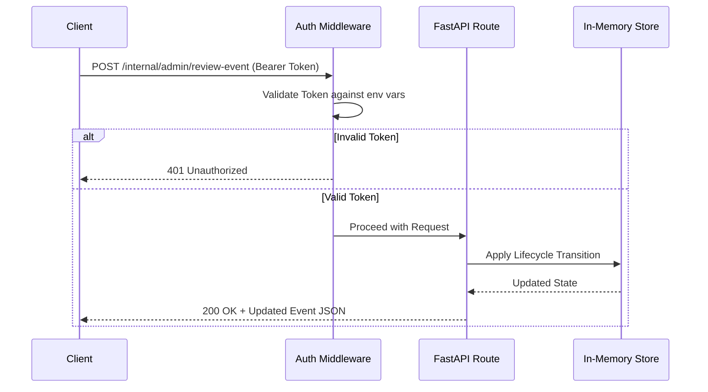

# API Contract

The project contains a programmatic REST API built with **FastAPI**. While the primary user experience is via the Streamlit dashboard (`streamlit_app.py`), the FastAPI application (`src/pakistan_flood_monitor/api/main.py`) exposes endpoints for systemic monitoring, third-party integration, and administration.

> **Note**: Currently, the FastAPI application uses an **in-memory storage model** for operational state (run history, events, review logs). Restarting the FastAPI server will reset this state.

## Starting the API

```bash
APP_MODE=demo uvicorn pakistan_flood_monitor.api.main:app --reload --port 8000
```

## Authorization

Endpoints under `/internal` require a Bearer token in the `Authorization` header.
- For Analyst actions: Use the token specified in `FLOOD_MONITOR_ANALYST_TOKEN`.
- For Admin actions: Use the token specified in `FLOOD_MONITOR_ADMIN_TOKEN`.
- Reviewer and service roles use `FLOOD_MONITOR_REVIEWER_TOKEN` and `FLOOD_MONITOR_SERVICE_TOKEN`.

Unsigned `v1.<base64 JSON>` identity tokens are no longer accepted: they were forgeable.
Replace them with a configured role secret. Audit identities for these secrets are role-based;
they do not establish an individual user identity or token expiry. Rotate any exposed secrets.

Endpoints under `/public` are unauthenticated.

## Request / Response Flow



## Core Endpoints

### Public Routes (`/public`)
- `GET /public/corridors`: Returns the list of active monitored river corridors.
- `GET /public/corridors/{aoi_name}/events`: Returns active flood events for a given corridor.
- `GET /public/events/{event_id}`: Retrieves details for a specific flood event.
- `GET /public/alerts/feed`: Returns a feed of recent alerts.

### Internal Routes (`/internal`)

#### Operational Runs
- `POST /internal/run/{aoi_name}`: Manually triggers the flood monitoring pipeline for a corridor.
- `GET /internal/runs`: Lists recent pipeline execution runs.

#### Analyst Review Workflow
- `POST /internal/admin/review-event`: Advances an event through the lifecycle (`draft` -> `review` -> `approved` -> `published`).
- `POST /internal/field-reports/{report_id}/moderate`: Moderates a crowdsourced field report.

#### Settings & Configurations
- `POST /internal/admin/register-threshold`: Updates threshold weights (requires Admin).
- `GET /internal/monitoring/metrics`: Exports Prometheus-compatible operational metrics.

### Publication lineage

Outside test mode, the publication gate rejects missing or malformed observation lineage. Each
required observation must include its matching name, a finite value, units, status, availability,
source URI, timezone-aware source timestamp, processing version, and quality status. Available,
non-synthetic metadata is necessary but does not by itself establish that a source is authentic,
current, scientifically validated, or authorized for public warning. Existing producers with incomplete
lineage must populate these fields before publication. The separate latest-run and mobile-advisory
routes still need a reviewed-product publication design and must not be relied on for operational use.

### Concurrent workflow requests

A workflow execution claims its persisted run before processing. A duplicate request observes the
existing run; `GET /internal/run/{aoi}` returns HTTP 409 with `workflow_in_progress`, its run ID and
status while the existing run is queued or running. Explicit retry claims only a terminal run, and
uses its original persisted run ID. A queued or running run left after a crash cannot be reclaimed
automatically: safe recovery requires worker ownership/fencing and an operator procedure, which are
not implemented. Do not reset an active worker's state directly.
A failed or degraded run without a successful report returns HTTP 503 with `workflow_not_successful`;
a stale report from an earlier attempt is not returned as a successful result.
