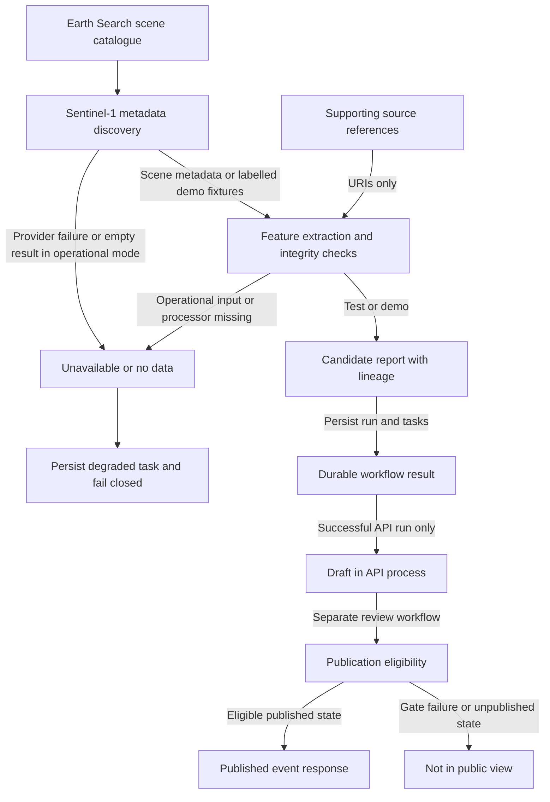

# Environmental processing and data contracts

The canonical route starts with a configured corridor and a run request.
See the [runtime architecture](architecture.md) for the entry points and
[ADR-001](adr/ADR-001-canonical-runtime.md) for data integrity requirements.

## B. Processing and availability

`DataCatalog.fetch_scenes` queries Earth Search for metadata. The daily runner
requests Sentinel-1 scenes for its configured corridor and a recent date
window. A provider error or empty result in operational mode raises a typed
integrity error, with the observation distinguishing `UNAVAILABLE` from
`NO_DATA`. `fetch_supporting_layers` provides URLs and a bounding box.
Those URLs do not represent measurements downloaded into the run.

`SceneFeatureExtractor.extract` builds typed observations. The provisional SAR
feature uses available local, non-synthetic VV rasters and compares means when
at least two arrays are readable. It does not establish a calibrated backscatter
change model. Canonical NDWI, IMERG rainfall, GloFAS return period and floodplain
distance are currently unimplemented as real feature inputs. Operational mode
stops on missing inputs and also has a separate gate for the absent validated
hazard, flood extent and exposure processors. No operational candidate
pipeline completes today.

Test/demo can use deterministic fixtures for missing features. On success the
extractor writes a feature snapshot, and the runner builds a report with run
and event lineage. The workflow repository persists the result as task
metadata. A CLI or worker invocation does not populate the API review state.
A successful API run records a draft, then review and publication are explicit
API actions. The depicted public edge applies only to an eligible published
record. Outside tests the gate rejects synthetic lineage, so a simulated
candidate is not publishable through this path. See [API publication](api.md#publication-lineage).

`WorkflowEngine.execute` records a degraded run and task on a structured
integrity error. The API returns 503 and the CLI reports the integrity error
with exit 2. The top-level error is `UNAVAILABLE`. Observation detail can
carry the more specific reason and availability. General exceptions mark
failed tasks and do not produce new public events.

**Traceability:** `data/sources.py`, `pipeline/feature_generation.py`,
`pipeline/runner.py`, `workflow/engine.py` and `api/main.py` in the canonical
package. Entry points include `flood-monitor run`, admin
`POST /internal/run/{aoi_name}` and `GET /public/events`. Tests include
`tests/test_operational_data_integrity.py`, `test_canonical_runner_scene_features.py`,
`test_publication_boundary.py` and `test_workflow_foundation.py`. Related work
is DATA-001, GIS-001, P1-003, PK-008 and PK-011 in the
[master task plan](engineering/MASTER_TASK_PLAN.md).

## Meaning, freshness and provenance

| Contract | Current implementation and limitation |
|---|---|
| Observation versus forecast | `models/observations.py` defines physical meaning, including observed, forecast, estimated, simulated, field-reported, official and unavailable. The mode and label describe the data. A probability, candidate, forecast or field report does not establish measured inundation or an official warning. |
| Availability | `ScientificObservation` records availability, reason, evaluation time, units, quality and optional source/freshness. Unavailable and no-data observations have no numerical value. The integrity summary distinguishes `AVAILABLE`, `NO_DATA`, `DEGRADED`, `STALE`, `PARTIAL` and `UNAVAILABLE`. A status field alone does not prove freshness is evaluated. |
| Lineage and timestamps | Run/event lineage keeps sources, processing/model/threshold versions, observations and simulation metadata. Scene lineage currently converts acquisition dates to midnight UTC, and discovery substitutes its window start if the provider item has no datetime. Treat that field as a date-level approximation. Processing, detection, source time and publication are separate. The API's current `published_at` is set when constructing the draft, so it cannot establish the approval time or feed freshness. |
| Geospatial units | `geo/measurements.py` uses WGS84 geodesics for km or km², and a local azimuthal-equidistant projection for metre distances and buffers. GeoJSON coordinates are longitude/latitude. Established measurement helpers and geometry QA do not establish availability of an operational raster or exposure processor. |
| Public acceptance | `services/gis_qa.py` checks geometry, event semantics, review metadata and scientific lineage. `services/publication_eligibility.py` checks available non-synthetic observations, finite values, source URI/time, processing version, units and quality metadata. A qualifying record still requires reviewed state and does not certify source authenticity or warning accuracy. |

Tests include `tests/test_integrity_summary_regression.py`,
`test_geo_measurements.py`, `test_lineage_schema.py` and
`test_publication_lineage_boundary.py`. The observation and GIS requirements
come from [ADR-001](adr/ADR-001-canonical-runtime.md) and the repository
operating contract. Freshness, precision and publication follow-ups are in
DATA-001, GIS-001 and P1-003.

## Research and integration boundaries

| Surface | Actual relationship | Maturity |
|---|---|---|
| Satellite and hydromet views | Page 9 uses `DataCatalog`; page 10 uses `nasa_service.py` for NASA POWER and Earthdata product helpers. | Direct research queries, separate from canonical required observations. |
| Water detection and SAR terrain | Page 11 uses `satellite_ml_service.py` and local assets. Page 14 uses `services/advanced_ml_service.py`. | RGB proxy and simulated SAR/terrain analysis. |
| Forecast and dam views | Page 13 uses `services/forecast_service.py` for provider precipitation and prototype water-level estimates. Page 15 uses `services/dam_service.py` for surface-extent proxies. | Standalone demo/test only. Forecast model and downstream risk are unvalidated. The surface proxy gives no storage or release measurement. |

The repository contains provider and GIS code in both canonical and legacy
trees. There is no current edge from these research results to validated
workflow inputs or reviewed public products. Evidence includes
`tests/test_safety_gates_and_community_reporting.py` and
`test_backtesting.py`. See [implementation status](engineering/IMPLEMENTATION_STATUS.md)
and PK-008/PK-011 for independent validation work.
