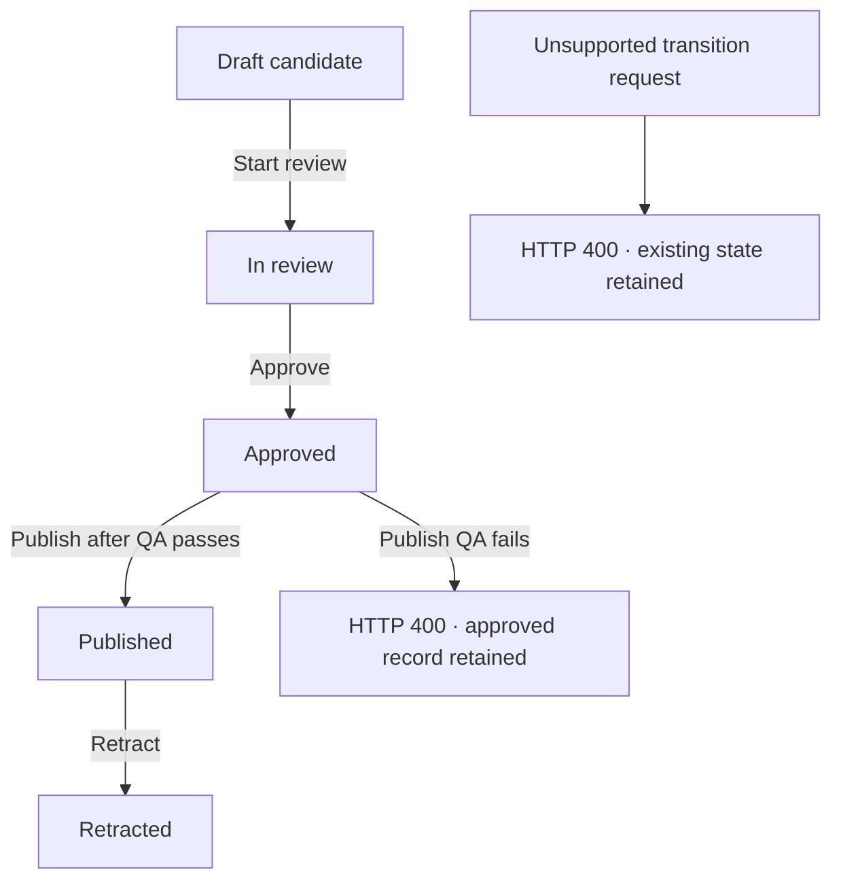
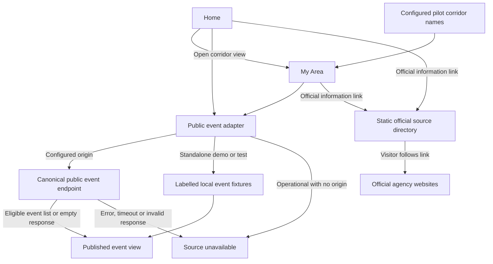
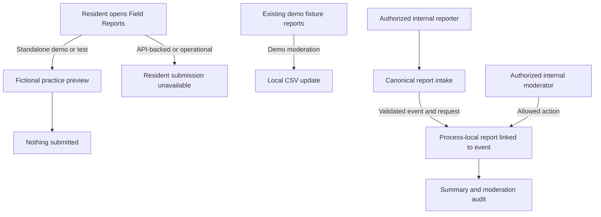

# Public, review and reporting flows

This page maps the current service and UI paths. See
[runtime architecture](architecture.md) for entry points and
[ADR-001](adr/ADR-001-canonical-runtime.md) for the integrity boundary.

## C. Canonical flood event lifecycle

The canonical API stores a new event as `draft` when recording a successful
run. A detection's `review_status` and the record's `queue_status` are
separate from the API lifecycle. The exact transitions are
`draft → review → approved → published → retracted`. Retracted is terminal.
The handler normalizes `accept` and `accepted` to `approved`, `publish` to
`published`, and `reject` to `retracted`. The last alias is only valid from
`published`. Canonical rejection of a draft is not an implemented transition.

`POST /internal/admin/review-event` accepts admin, analyst and reviewer
roles. The handler validates the state transition, applies edits to a copy
and evaluates the publication gate. Failed publication returns HTTP 400
with `qa_failed` and leaves the shared record unchanged. A supplied
`reviewed_geometry` requires both label metadata and mapping rules. An
approval can exist with QA errors that would block publication.

The public collection requires `published` and rechecks QA outside test.
Test mode still uses lifecycle state, with synthetic-lineage checks relaxed
for test fixtures. A published event is a reviewed application record.
Official warning authority and scientific validity are separate. The
read-only Streamlit queue lists `draft`, `review` and `approved` records
from the current API process. Review mutations and audit entries are not
durable across restarts.

**Traceability:** Canonical `api/main.py` owns `LIFECYCLE_TRANSITIONS`,
`_record_run`, `admin_review_event` and `_is_public_event`.
`services/gis_qa.py` owns the publication gate. Entry points include
`GET /internal/review-queue`, `POST /internal/admin/review-event` and
`GET /public/events`. Evidence includes `tests/test_api_implementation.py`,
`test_publication_boundary.py`, `test_publication_lineage_boundary.py`,
`test_canonical_review_queue.py` and `test_reused_run_preserves_review.py`.
See [API review contracts](api.md#analyst-review-workflow) and P1-002, P1-003
and SEC-001 in the [master plan](engineering/MASTER_TASK_PLAN.md).

## D. Home, My Area and official information

Home and My Area issue one `GET /public/events` request per render when the
API is configured, with a two-second timeout. The local adapter filters the
event view to published rows. My Area reads the corridor catalogue from
configuration and filters by exact association. An absent association
stays in the all-events view. Changing the corridor reruns the page. Empty
responses and outages preserve corridor selection and official links. An
API error does not trigger fixture fallback. Map rendering is optional,
and operational feed freshness is unavailable when no update time is supplied.
The official directory links to source pages and does not ingest bulletins.

**Traceability:** `streamlit_app.py`, pages 1 and 16, `backend_service.py`
(`get_events`, `get_public_events`), `public_information.py`,
`official_sources.py` and canonical `api/main.py` (`list_public_events`).
Tested by `tests/test_streamlit_public_pages.py`,
`test_public_preparedness_journeys.py` and `test_official_sources_directory.py`.
See UI-001, P0-001, PK-001, PK-002 and PK-003 in the
[master plan](engineering/MASTER_TASK_PLAN.md). Device and provider timing
remain outside that fixture evidence.

## E. Field-report workflow

The practice form uses categories and coarse corridor choice. It returns a
preview without a receipt or a queue entry. Moderating existing demo
records is a separate operation that updates the CSV using a temporary
file and replacement. This path is closed when the API is configured or
the app is operational.

The canonical `POST /internal/reports/field` route requires admin, analyst
or reviewer. It validates the event, coordinates and request limits.
A matching duplicate from the same role principal and event returns
`accepted_duplicate`. Conflicting reuse returns HTTP 409 without the
existing report. The report and linked summary are in the current API
process. `POST /internal/field-reports/{report_id}/moderate` requires admin
or analyst. For submitted reports it allows approval, rejection, more
information or spam flagging. A report needing more information can be
approved, rejected or flagged. Approved reports can be rejected. Rejected
and flagged records are terminal. Trust is explicit in an approved
internal report. Moderation cannot turn the report into a measured flood
observation. Durable resident intake, private receipts and restart-safe
moderation are tracked separately.

**Traceability:** Page 3, `backend_service.py` (`get_field_reports` and
`moderate_report`) and canonical `api/main.py` (`ingest_field_report`,
`moderate_field_report`). Evidence includes `tests/test_field_report_boundaries.py`,
`test_api_implementation.py` and `test_public_preparedness_journeys.py`.
See [API access roles](api.md#authorization) and PK-006, P1-002 and SEC-001 in the
[master plan](engineering/MASTER_TASK_PLAN.md).

## Exports and notification delivery

| Surface | Current contract and limitation | Evidence |
|---|---|---|
| Streamlit Export Center | Standalone demo/test GeoJSON event point and provenance manifest. Files can be downloaded. API-backed and operational exports are unavailable here. | Page 5 and `backend_service.py` (`generate_export`), `tests/test_streamlit_demo_export.py` and `test_export_center.py`. UI-001 and P1-003. |
| Internal API exports | Role-protected SitRep PDF at `POST /internal/admin/sitrep/export` and historical/training package at `GET /internal/admin/historical-events/export`. PDF and package outputs are operator tools with prototype inputs and fields. They have no official warning or delivery authority. | Canonical `api/main.py` (`admin_export_sitrep`, `admin_export_historical_events`), `tests/test_api_implementation.py`. P1-003 and PK-009. |
| Notifications | `NotificationDispatcher` implements opt-in checks, attempted delivery and retries with an instance-local audit log. Bundled SMS, email and WhatsApp providers are stubs that return constructed IDs. No automatic canonical event-publication-to-delivery path is wired. | `services/notifications.py`, `tests/test_notifications.py`. PK-004 and PK-009. |

See [API contracts](api.md) for payload discovery and access boundaries and
[implementation status](engineering/IMPLEMENTATION_STATUS.md) for remaining
verification.
