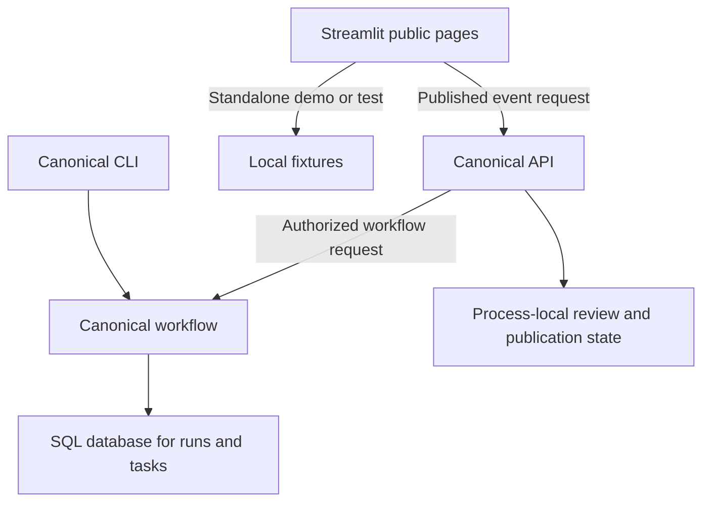

# Runtime architecture

The canonical runtime is the `pakistan_flood_monitor` package. FastAPI, the
`flood-monitor` CLI and the canonical workflow share integrity rules.
[ADR-001](adr/ADR-001-canonical-runtime.md) records that decision.

## Entry points

| Surface | Entry point | Current behavior |
|---|---|---|
| Canonical FastAPI | `pakistan_flood_monitor.api.main:app` | Public event and source contracts, protected operational routes and workflow access |
| Canonical CLI | `flood-monitor run`, `flood-monitor run-status` | Run the canonical workflow or inspect durable run and task records |
| Streamlit | `streamlit_app.py` | Home plus 18 registered pages using one menu. API-backed Home and My Area read `/public/events`. The analyst queue uses a supplied role credential. |
| Standalone HTML | `dashboard_app:app` | Separate demo/test prototype with a local mock feed |
| Legacy package | `src/app/` | Deprecated compatibility and migration source with a separate Alembic history |

Some Streamlit research pages use direct provider helpers or local assets.
Their existence does not establish a canonical operational provider pipeline.
See [implementation status](engineering/IMPLEMENTATION_STATUS.md).

## Public reads and workflow persistence

Durable runs and task status use the SQLAlchemy workflow repository. API event
and review state, the queue read model, reports, audit entries and other
registries are still partly process-local. An administrator can export and
restore a runtime snapshot. That explicit operation does not provide an
automatic restart recovery or multi-worker consistency contract.

Use the canonical root Alembic chain, currently at `b4d9d93f2a10`, for the
canonical database. The legacy chain under `src/app/db/alembic/` is independent.
See [deployment](deployment.md) for migration commands and
[the task plan](engineering/MASTER_TASK_PLAN.md) for worker fencing and durable
review work.

## Modes and decision boundaries

| Mode | Data and publication policy |
|---|---|
| `test` | Deterministic fixtures for automated contracts |
| `demo` | Visibly labelled synthetic data for demonstrations |
| `operational` | Required observations and lineage must be traceable. Missing required inputs produce unavailable results. |

The publication gate protects the eligible event view. Reviewed products,
external warning authority and independently validated observations are
separate concerns. See [API contracts](api.md) and [public limitations](overview.md).
