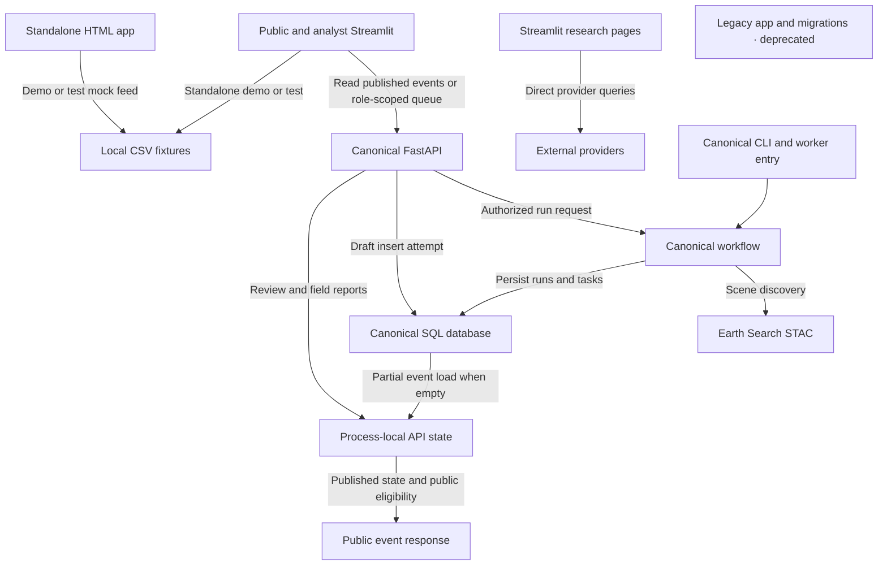

# Runtime architecture

The canonical runtime is the `pakistan_flood_monitor` package. FastAPI, the
`flood-monitor` CLI and the canonical workflow share integrity rules.
[ADR-001](adr/ADR-001-canonical-runtime.md) records that decision.

## Entry points

| Surface | Entry point | Current behavior |
|---|---|---|
| Canonical FastAPI | `pakistan_flood_monitor.api.main:app` | Public event and source contracts, protected operational routes and workflow access |
| Canonical CLI | `flood-monitor run`, `flood-monitor run-status` | Run the canonical workflow or inspect durable run and task records |
| Streamlit | `streamlit_app.py` | Home plus 18 registered pages using one menu. API-backed Home and My Area read `/public/events`. The analyst queue uses a supplied role credential. |
| Standalone HTML | `dashboard_app:app` | Separate demo/test prototype with a local mock feed |
| Legacy package | `src/app/` | Deprecated compatibility and migration source with a separate Alembic history |

Start the server, dashboard or CLI from [local setup](setup.md). The checked-in
Compose stack starts the canonical API and Streamlit in demo mode with PostGIS.
It does not start a scheduled workflow worker. The Dockerfile targets Python
3.11 and the offline CI definition uses Python 3.12. See [deployment](deployment.md)
and [tests](testing.md) for validation scope.

## A. Current runtime architecture

Arrows identify calls or data movement and their labels give the direction.
The isolated legacy node is a separate code and migration history. The
research interfaces call providers or use local assets outside the canonical
workflow. The standalone HTML app reads its own demo event CSV through
`dashboard_app.py`. Streamlit uses `backend_service.py` for the public event,
review and demo paths. The database arrow for draft events represents a
best-effort write, while the workflow repository persists run and task
records through its own SQLAlchemy transactions.

Sources include `streamlit_app.py`, `dashboard_app.py`, `backend_service.py`,
`src/pakistan_flood_monitor/api/main.py`, `cli.py` and `workers.py` in the
canonical package, and `src/app/api/main.py`. Evidence includes
`tests/test_canonical_runtime_smoke.py`, `test_standalone_dashboard_boundary.py`
and `test_streamlit_public_pages.py`. Track integration maturity in the
[master task plan](engineering/MASTER_TASK_PLAN.md) under API-001, UI-001,
OPS-001 and DATA-001. [ADR-001](adr/ADR-001-canonical-runtime.md) governs the
canonical boundary.

## Public reads and workflow persistence

| Responsibility | Implementation and current boundary |
|---|---|
| Workflow runs and tasks | Durable via `WorkflowRepository` and the root Alembic schema. Inspect via `flood-monitor run-status` or the admin workflow route. |
| API run history and review lookup | `run_history` and `event_store` are process-local. `_record_run` also attempts to save a draft `FloodEvent` row. When the event store is empty, `_all_events` can hydrate a basic event row without full lineage or review history. |
| Review queue, decisions, report moderation and audit | These paths read or update in-memory state. The queue reads the current dictionary without triggering DB hydration. Admin snapshot export and restore are explicit operations. Automatic recovery and cross-worker consistency remain outstanding. |
| Research and demo assets | Feature snapshots at `.cache/feature_snapshots/`, prototype imagery and other local files under `storage/`, plus fixture CSVs under `data/`. These are distinct from the API event contract. |

Use the root Alembic chain, currently at `b4d9d93f2a10`, for the canonical
database. The legacy chain under `src/app/db/alembic/` is independent. See
[deployment](deployment.md) for migration commands. Restart and review
limitations are tracked in P1-001 and P1-002.

## Workflow retries and recovery

The daily definition currently has one `flood_daily_processing` task. The
generic engine supports dependency-aware tasks. Its idempotency signature
includes workflow name, AOI, mode, input versions and metadata. The daily
workflow includes a UTC runtime date and threshold settings in the versions.
It does not key the run on newly discovered scene contents.

`WorkflowEngine.execute` creates or finds a run, then atomically claims new
work. A duplicate request returns the persisted run. The API returns 409
for a queued or running run, and 503 for a non-successful terminal result.
An explicit retry via `flood-monitor run --retry` or the authorized reprocess
route claims terminal work and uses the same run ID, subject to task attempt
limits. A crashed queued or running job has no automatic reclaim path.
The worker callable can be invoked by a caller. There is no worker scheduler
in the checked-in Compose stack.

Sources are `workflow/contracts.py`, `workflow/flood_daily.py`,
`workflow/engine.py`, `workflow/repository.py` and `_workflow_report` in the
canonical API. Tests are `tests/test_workflow_foundation.py` and
`tests/test_workflow_concurrent_retry.py`. See
[API contracts](api.md) and the [task plan](engineering/MASTER_TASK_PLAN.md)
for P1-001 and P1-002.

## Modes and decision boundaries

| Mode | Data and publication policy |
|---|---|
| `test` | Deterministic fixtures for automated contracts |
| `demo` | Visibly labelled synthetic data for demonstrations |
| `operational` | Required observations and lineage must be traceable. Missing required inputs produce unavailable results. |

The publication gate protects the eligible event view. Reviewed products,
external warning authority and independently validated observations are
separate concerns. See [API contracts](api.md) and [public limitations](overview.md).

Continue with [environmental processing and data contracts](architecture-environmental-data.md),
[public, review and reporting flows](architecture-user-and-review-flows.md), and the [agent recovery workflow](engineering/AGENT_GITHUB_WORKFLOW.md).
