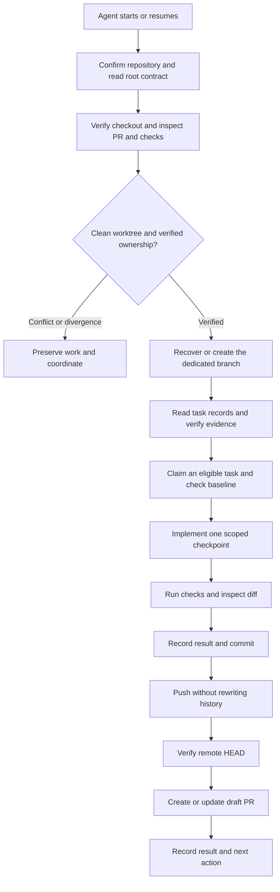

# Resumable GitHub workflow for coding agents

Status: IN PROGRESS. This guide governs repository-connected agents alongside AGENTS.md.
The master task plan is the authoritative checklist; the session log is the handoff.
User instructions and repository safety rules take precedence. Do not merge automatically.

## F. Agent recovery and handoff



This is a navigation aid for the existing procedure below. Verification
uses the actual remote ref and the PR head, base and status. A rejected push
leaves the local commit intact. Recover from the last verified checkpoint
and the task plan before taking another slice. When a check fails, record the
actual outcome and leave the PR draft while repairing it.

**Traceability:** Repository-root `AGENTS.md`, this workflow, the
[master task plan](MASTER_TASK_PLAN.md) and the [session handoff log](AGENT_SESSION_LOG.md).
Optional scripts are `scripts/agent_preflight.sh`, `scripts/agent_resume.sh` and
`scripts/agent_checkpoint.sh`. Their isolated regressions live in
`tests/test_agent_git_workflow.py`. Task ENG-001 tracks workflow acceptance
and hosted verification. [ADR-001](../adr/ADR-001-canonical-runtime.md) governs
which runtime the agent may extend.

## Start or resume

1. Confirm repository identity. Inspect branch, HEAD, upstream, remotes,
   changed files and untracked paths without printing credential-bearing
   URLs. Read the root `AGENTS.md` on the starting checkout. Preserve
   all local changes.
2. Fetch remote metadata. Inspect open PRs for the workstream, including
   the head and base, commits, review comments, changes and checks.
   Verify the current remote head and coordinate ownership. If PR listing
   is unavailable, report the gap and use an authorized alternative.
3. Recover the verified open PR branch in a clean worktree using a
   fast-forward only. If no suitable open PR exists, branch from the
   latest intended base. Preserve ahead or divergent commits and
   coordinate before updating an ambiguous or dirty checkout.
4. Read `AGENTS.md` on the recovered branch, [applicable ADRs](../adr/README.md),
   the [master task plan](MASTER_TASK_PLAN.md), the latest
   [handoff](AGENT_SESSION_LOG.md), the [implementation ledger](IMPLEMENTATION_STATUS.md)
   and [relevant guides](../INDEX.md). Verify completion claims against code,
   tests and Git history. Consult recent merged PRs when they affect the task.
5. Choose one authorized, eligible task. Check dependencies and record the
   existing task ID and ownership in the plan or handoff. Coordinate work on
   shared branches and avoid overlapping files. Markdown ownership is
   advisory. Use the existing plan and preserve previously verified work.
6. Run the appropriate [baseline checks](../testing.md), then begin the
   selected task. Record exact failures and distinguish pre-existing,
   environmental and newly introduced failures.

## Small, durable checkpoints

Break the approved workstream into small reviewable units. After approximately 60–120 seconds of
meaningful editing, or a coherent subtask, whichever comes first: inspect the diff, run an appropriate
lightweight check, record the actual status and exact next action in the existing handoff, stage
only intended files, inspect the staged diff and `git diff --cached --check`, commit and push.
Aim to avoid five minutes of unpushed useful work. Do not interrupt an atomic change to meet a
timer; do not create artificial or empty commits. Tests or syntax checks may fail on a necessary
WIP checkpoint; clearly record the failure and keep the PR draft. Never mark unverified work done.

Before staging, review paths and contents for secrets, credentials, private data, generated
databases and unrelated changes. Never use indiscriminate staging in a shared workspace. A script
cannot guarantee secret detection; manual review and approved scanners remain necessary. Use only
authorized credentials and never print them.

After every checkpoint, push a normal fast-forward to the assigned branch and compare local HEAD to
the actual remote branch head (for example `git ls-remote origin refs/heads/<branch>`). A local
commit or attempted push alone is not a durable checkpoint. Check the open PR head/base and draft
state; inspect CI and review feedback at milestones. Never force-push or rewrite published commits.
If the push or authentication fails, preserve the commit, report the exact failure without secrets,
and reconcile remote history before retrying. If remote history has diverged, stop and coordinate.

Create one draft PR to main immediately after the first meaningful pushed checkpoint if no suitable
PR exists. Use the existing template; summarize task ID, scope, milestones, tests, limitations and
next action. Continue pushing the same branch; do not create a duplicate PR after a reset. Update
the PR description at milestones. If a user or higher-priority instruction prohibits a PR, honor it.
If the PR is closed or merged, reassess the workstream before opening another.

## Failures, completion and handoff

Investigate test failures and distinguish pre-existing, environmental, WIP and new regressions.
Never claim a test passed without running it. Run full applicable checks before human review.
Mark a subtask complete only with evidence, preserving all other backlog items. Keep the PR draft
until acceptance criteria are met. Report blockers and unverified scenarios rather than inventing
requirements. Do not change production data, deploy or merge unless separately authorized.

Append compact entries to AGENT_SESSION_LOG.md: UTC time, repository, workstream, branch and PR,
base and last verified remote SHA, task ID/status, completed and pending work, changed files, exact
test results, failures/blockers, worktree/unpushed status and next action. A commit cannot contain
its own SHA; record the preceding verified remote SHA and verify the new SHA after pushing. On
interruption recover from GitHub commits, PR and tracked plan even if a handoff is missing.

At completion inspect the cumulative diff, run applicable tests and security checks, document
limitations and rollback, and request human review. Close a workstream only after its agreed
acceptance; select a new one only when authorized, following AGENTS.md.

References: [GitHub flow](https://docs.github.com/en/get-started/using-github/github-flow),
[GitHub draft PRs](https://docs.github.com/en/pull-requests/reference/pull-requests),
and [OpenAI's multi-hour execution plans](https://developers.openai.com/cookbook/articles/codex_exec_plans).

## Optional local Git helpers

Invoke these scripts with Bash (their executable bit is not required):

```bash
bash scripts/agent_preflight.sh --dry-run <workstream-search>
bash scripts/agent_preflight.sh <workstream-search>
bash scripts/agent_resume.sh --dry-run <verified-pr-branch>
bash scripts/agent_resume.sh <verified-pr-branch>
# Review and explicitly stage each intended file, then inspect the full staged diff:
git diff --cached
bash scripts/agent_checkpoint.sh --dry-run <expected-branch> 'task-id: descriptive message'
bash scripts/agent_checkpoint.sh <expected-branch> 'task-id: descriptive message'
```

Preflight fetches unless dry-run, reports status and lists PRs when authenticated `gh` is available.
If not, use an authorized GitHub integration; inability to list PRs is not evidence that none exists.
Check repository identity, review comments, checks and ownership separately. Resume accepts an
already verified PR branch and refuses dirty or divergent work; it does not select a PR for you.
The checkpoint helper never stages files; it screens some common sensitive paths and patterns but
does not detect every secret, protected file, symlink, binary or private datum. Review all staged
content and use approved security tooling. It does not validate task completion or verify CI.
A failed push leaves the new commit local. A successful push followed by failed remote verification
is still unverified. Dry-run does not commit, push, fetch or switch branches.

The existing offline CI runs on pushes and pull requests. Frequent checkpoints can generate
redundant runs; concurrency cancellation was evaluated but left unchanged here because branch and PR
events have different check contexts and cancellation must not leave required checks unresolved.
Inspect CI at milestones and before review.
